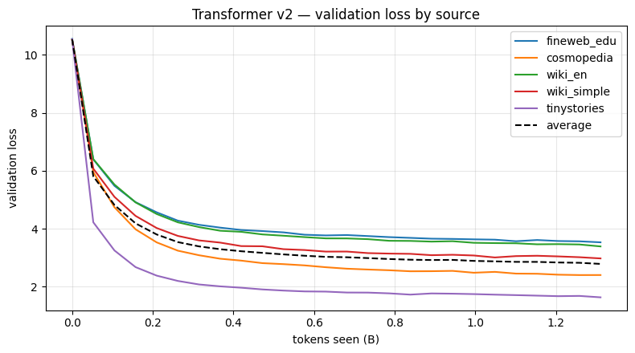

# 🌌 AI Space Stories

**I trained a 100M-parameter language model from scratch on free GPUs, and taught it to write space lore.**

You give it tags, and it writes a short piece of a sci-fi universe:

```
type: planet | name: Oris | climate: tidally locked | size: giant | danger: extreme
feature: a strange repeating signal | mood: melancholic | located_in: Morenae | length: short
```
> Oris, a giant tidally locked planet in the Morenae system, is a world of stark contrasts. Its dayside is
> perpetually bathed in sunlight, while the nightside hosts a thick, toxic atmosphere that glows with eerie
> green hues. […] What makes Oris truly memorable is the strange repeating signal emanating from its polar
> regions—a haunting, rhythmic pulse that seems to shift and change with each passing hour.

It runs on a **GTX 1650 laptop GPU** and generates a full star system (planets, factions, species, a station) in seconds.

This repo is the whole journey, written for someone who **knows Python and a little maths and is new to LLMs**. It starts where [Andrej Karpathy's "Let's build GPT"](https://www.youtube.com/watch?v=kCc8FmEb1nY) ends, and explains every step after that: what I changed, why, what it cost, and what failed.

---

## Results at a glance

| Stage | What | Result |
|---|---|---|
| 1. Karpathy's GPT | 0.2M char model, Shakespeare | val loss 1.82 (his notebook, my starting point) |
| 2. My GPT v1 | 13.8M, TinyStories, own BPE tokenizer | val loss **1.50**, coherent kids' stories, 56 min on 1 T4 |
| 3. GPT v2 pretraining | **100.7M**, Llama-style, 1.5B tokens of web + Wikipedia + textbooks + stories | fluent English, ~12 h on 2× T4 |
| 4. Q&A fine-tuning | 188k conversations (SQuAD + Dolly + chats), 75 min | ✅ reading a given text: **32% exact match** on SQuAD · ❌ answering facts from memory: often made up |
| 5. Space lore | distilled from a 7B teacher (Qwen2.5) | ✅ **13% → 93%** of outputs pass all checks |

**Space lore, before vs after fine-tuning** (45 unseen tag sets):

| Metric | Base 100M | **Fine-tuned 100M** | Teacher (Qwen 7B, 70× bigger) |
|---|---|---|---|
| Passes all checks | 13% | **93%** | 100% |
| Uses the given name | 53% | **98%** | 100% |
| Variety (distinct 4-grams) | 0.72 | **0.97** | 0.94 |
| Median length (target ≈ 120 words) | 173 | **119** | 117 |

**Total cost: €0.** Everything ran on Kaggle's free GPUs (about 20 GPU-hours) and my own laptop.

---

## The story in five steps

### Step 1: Start with Karpathy
His notebook ([`ng-video-lecture`](https://github.com/karpathy/ng-video-lecture)): characters in, one Transformer, Shakespeare out. If attention is new to you, **watch his video first**. Everything here builds on it.

### Step 2: Make it real (GPT v1)
[`notebooks/01_gpt_v1_tinystories.ipynb`](notebooks/01_gpt_v1_tinystories.ipynb): same idea, made practical.
- **BPE tokenizer** instead of characters, so the model sees ~4 characters per step instead of 1.
- **TinyStories** dataset, so a small model can actually learn grammar and plot.
- **KV-cache, mixed precision, LR schedule, checkpoints, tests** (does the future leak into the past? does the cache give the same answer?).

### Step 3: Scale up to 100M (GPT v2)
[`02_data_prep`](notebooks/02_data_prep.ipynb) → [`03_pretrain_v2`](notebooks/03_pretrain_v2.ipynb). I swapped in the parts that modern models (Llama, Qwen, Mistral) use:

| Karpathy / GPT-2 | This repo | Why, in one line |
|---|---|---|
| Learned position embeddings | **RoPE** | Positions as rotations: relative distance comes for free |
| LayerNorm | **RMSNorm** | One statistic fewer, same quality |
| GELU MLP | **SwiGLU** | A "dimmer switch" per neuron, better at equal size |
| 12 key/value heads | **GQA**: 4 key/value heads | 3× smaller cache, faster chat on a small GPU |
| — | **QK-norm + z-loss** | Keeps numbers small, so fp16 on old T4s doesn't explode |
| Cosine LR | **WSD** (warm-up → stable → decay) | Resumable across 12 h Kaggle sessions |
| 1 GPU | **2 GPUs (DDP)** | Kaggle gives two T4s, so use both |

Data: 1.5B tokens from FineWeb-Edu, Cosmopedia, Wikipedia, Simple Wikipedia and TinyStories, with one shared 32k tokenizer.



### Step 4: Q&A, half a success
[`04_sft_qa`](notebooks/04_sft_qa.ipynb). I fine-tuned the model on 188k conversations. It learned the **format** perfectly: it answers in one go, then stops.

| Question | Base model (before) | Fine-tuned (after) |
|---|---|---|
| What is the capital of France? | "Capital is a set of assets…" | "The capital of France is Paris." ✅ |
| How many legs does a spider have? | "A spider has a legs. A spider has legs…" | "A spider has six legs." ❌ |
| What is the largest planet in our solar system? | "…Earth is the smallest planet…" | "The largest planet in our solar system is the Earth." ❌ |
| Who wrote Romeo and Juliet? | "Romeo and Juliet are two famous romantic novels…" | invents a "Roman poet Irene Caelestino" ❌ |

- **Answering from a given text works:** on SQuAD the model gets **32% exact match, 40% F1**, roughly where the first neural reading models were in 2016.
- **Answering from memory doesn't:** a 100M model trained on 1.5B tokens stores very little knowledge, so it confidently makes things up. (GPT-2 small saw ~10B tokens; useful assistants start at 1B+ parameters and trillions of tokens.)

**Lesson:** fine-tuning teaches *behaviour*, not *knowledge*.

### Step 5: The pivot that worked, space lore
Pick a task where **fluency and creativity matter, and facts don't**. Then:
1. [`05_lore_datagen`](notebooks/05_lore_datagen.ipynb): a **world schema** (9 entity types: planets, factions, species, ship logs…) produces 22,000 random tag sets. **Qwen2.5-7B** (run with vLLM on 2× T4) writes the lore: 1.5 h, 18k pieces kept after quality filters.
2. [`06_lore_sft`](notebooks/06_lore_sft.ipynb): fine-tune the 100M model on them (20 min) and score it automatically with the same checks.

This is **knowledge distillation**, the same idea used to build many small open models.

---

## Try it yourself

**Run the Lore Forge app** (any NVIDIA GPU with 2 GB+, or CPU):

```bash
git clone https://github.com/prashant558/ai-space-stories.git
cd ai-space-stories
pip install -r requirements.txt
# download lore_forge_export.zip from the Releases page and unzip it into ./model
python apps/lore_forge.py --model_dir model      # opens http://127.0.0.1:7860
python apps/lore_forge.py --model_dir model --cli   # or: lore in the terminal
```

The Q&A model works the same way: `tv2_chat_export.zip` → `python apps/chat_app.py --model_dir chat_model`.

**Retrain everything:** open the notebooks on Kaggle in order (01 → 06). Each one starts with a *How to run* cell and pre-flight checks.

---

## What a 100M model still gets wrong

It's fluent and on-format, but weak on **logic**:
- **Contradictions:** in the Oris piece above, the nightside "glows green" and is also "shrouded in perpetual twilight".
- **Counting:** in a two-planet system it calls a planet "the fourth".
- **Mixing up roles:** a faction gets its homeworld's name.

More data won't fix these. A bigger model will. See [docs/07_results_and_lessons.md](docs/07_results_and_lessons.md).

---

## Learn the concepts

Each doc goes **plain idea → tiny worked example with numbers → the exact code lines**.

| Doc | Covers |
|---|---|
| [00 Roadmap](docs/00_roadmap.md) | What to read in which order |
| [01 Tokenizer](docs/01_tokenizer.md) | BPE by hand on a 10-word example |
| [02 From Karpathy's GPT](docs/02_from_karpathy.md) | Attention, blocks, loss; what v1 adds |
| [03 Modern upgrades](docs/03_modern_upgrades.md) | RoPE, RMSNorm, SwiGLU, GQA, QK-norm |
| [04 Pretraining on free GPUs](docs/04_pretraining_free_gpus.md) | fp16, DDP, WSD, checkpoints, Kaggle tricks |
| [05 Fine-tuning](docs/05_finetuning.md) | Chat format, loss masking |
| [06 Distillation](docs/06_distillation.md) | Teacher → filters → student |
| [07 Results & lessons](docs/07_results_and_lessons.md) | Numbers, failures, what I'd do next |
| [Glossary](docs/glossary.md) | Every term in one place |

---

## Repo layout

```
notebooks/   01–06, in order, saved with their outputs
src/         model_v2.py (the model) · train.py (pretraining) · lore_schema.py (tags + checks)
apps/        lore_forge.py (space lore UI) · chat_app.py (Q&A UI)
data/        world_schema.json
docs/        the explanations
assets/      plots and sample outputs (lore_samples.md)
```
Model weights (~230 MB each) are attached to the [Releases](https://github.com/prashant558/ai-space-stories/releases) page, not stored in git.

## Credits & licenses
- [Andrej Karpathy](https://github.com/karpathy): *Neural Networks: Zero to Hero*, nanoGPT.
- Data: FineWeb-Edu (ODC-By), Cosmopedia (Apache-2.0), Wikipedia (CC BY-SA), TinyStories (CDLA-Sharing), SQuAD (CC BY-SA), Dolly-15k (CC BY-SA), smol-smoltalk (Apache-2.0).
- Teacher: [Qwen2.5-7B-Instruct](https://huggingface.co/Qwen/Qwen2.5-7B-Instruct) (Apache-2.0).
- Code: MIT.
