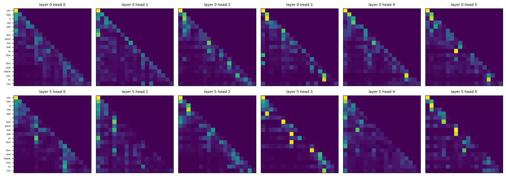
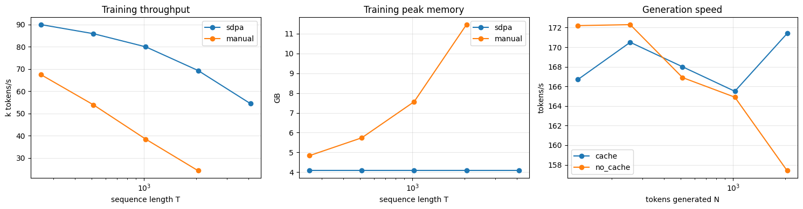
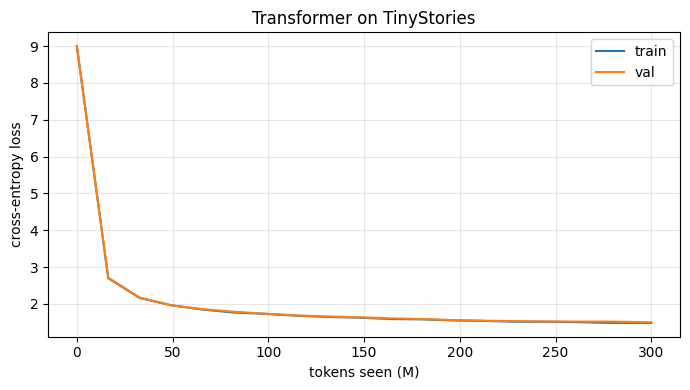

# 02 · From Karpathy's GPT to a real one (v1)

## Recap: what a GPT does
One job: **given the tokens so far, predict the next one.** Generating text = predict, pick a token, append, repeat.

```
"Once upon a"  ──►  model  ──►  probabilities: time 0.71 · day 0.05 · hill 0.01 …
```

### Attention in one example
Each token makes three vectors: a **query** ("what am I looking for?"), a **key** ("what do I contain?") and a **value** ("what I'll pass on").
The score between two tokens is `query · key` (a dot product). Scores → **softmax** → weights that sum to 1:

```
scores  [2, 1, 0]   →   softmax   →   [0.665, 0.245, 0.090]
softmax(x)_i = e^{x_i} / Σ e^{x_j}       e.g. e²/(e²+e¹+e⁰) = 7.39/11.11 = 0.665
```

The token's output is the weighted average of the values: 66.5% of token 1's value + 24.5% of token 2's + … A **causal mask** sets scores for *future* tokens to −∞ (→ weight 0), so the model can't cheat by looking ahead.

You can *see* this in our v1 model: each row is one token, bright squares show which earlier words it attends to.



### The loss
**Cross-entropy** = `−log(probability given to the correct next token)`.

| Model gives the right token… | Loss |
|---|---|
| probability 0.665 | −ln 0.665 = **0.41** |
| probability 0.090 | −ln 0.090 = **2.41** |
| random guess over 32,768 tokens | ln 32,768 = **10.4** |

That last row is a free sanity check: a freshly initialised model must start near 10.4 (ours: 10.53 ✓). A handy intuition: `e^loss` ≈ "how many tokens the model is unsure between". Loss 2.8 ≈ choosing among ~16.

## What v1 adds on top of Karpathy's notebook
Karpathy's notebook is a perfect *teaching* model. v1 keeps the same architecture and adds what you need to train something larger for real:

| Addition | What it does | Why |
|---|---|---|
| BPE tokenizer (8k) | see [01](01_tokenizer.md) | 4× more text per context |
| TinyStories dataset | 2M short children's stories | small models *can* learn grammar + plot here |
| **Weight tying** | input embedding = output layer | saves 3.15M params (23% of v1) |
| **Fused attention (SDPA)** | `F.scaled_dot_product_attention` | faster, much less memory (table below) |
| **KV-cache** | remember past keys/values while generating | don't recompute the whole prompt each token |
| **Mixed precision (fp16)** | do maths in 16-bit | ~2× faster on T4 GPUs |
| **Warm-up + cosine LR** | start gentle, peak, then cool down | stable start, better final loss |
| **Gradient clipping** | cap the gradient size at 1.0 | one bad batch can't wreck training |
| **Tests** | shapes, causality, cache = no-cache, overfit one batch | catch bugs *before* spending GPU hours |

### Fused vs manual attention (v1, T4)


| Context length | Manual attention | Fused (SDPA) |
|---|---|---|
| 256 | 67k tok/s, 4.8 GB | **90k tok/s, 4.1 GB** |
| 1,024 | 38k tok/s, 7.6 GB | **80k tok/s, 4.1 GB** |
| 4,096 | ❌ out of memory | **54k tok/s, 4.1 GB** |

Manual attention builds a full `T × T` score matrix per head, so memory grows with T². The fused kernel never stores it.

## v1 result
**13.8M parameters, 300M tokens, 56 min on one T4, val loss 1.50.**



It writes coherent little stories, which is exactly what TinyStories was designed to show. But it knows nothing outside that world. To get further, we need more parameters, more diverse data, and modern parts → [03](03_modern_upgrades.md).

*One surprise:* the KV-cache barely helped at this size (164 vs 156 tok/s). With only 14M parameters, the GPU is mostly waiting on Python, not doing maths. It matters more for bigger models and longer texts.
