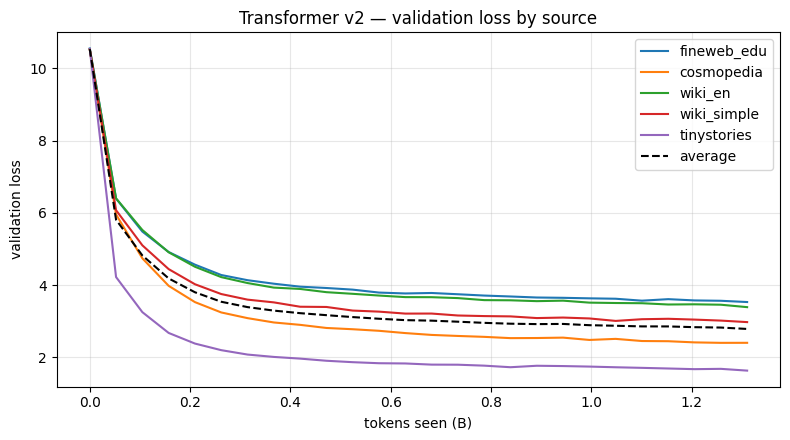

# 04 · Pretraining a 100M model on free GPUs

**Pretraining** = show the model a huge pile of text and train next-token prediction. The result is a **base model**: it continues text fluently but doesn't answer questions yet.

## The data (notebook 02, CPU only)

| Source | What | Tokens | Teaches |
|---|---|---|---|
| FineWeb-Edu | educational web pages | 450M | general knowledge, real writing |
| Cosmopedia v2 | synthetic textbooks | 550M | clear explanations |
| Wikipedia (en) | encyclopedia | 250M | facts, names |
| Simple Wikipedia | easy encyclopedia | ~72M (ran out of articles) | facts in plain language |
| TinyStories | children's stories | 150M | coherent narratives |
| **Total** | | **1.47B** | |

All of it is streamed from Hugging Face, tokenized once, and stored as `uint16` shard files (~3 GB). The notebook runs on Kaggle **CPU**, so it costs zero GPU quota.

**How much data for 100M parameters?** The "Chinchilla" rule of thumb is ~20 tokens per parameter for the best result at a fixed compute budget. We trained 1.5B tokens ≈ **15 per parameter**: slightly under, chosen to fit two Kaggle sessions.

## Training (notebook 03 + `src/train.py`)

### Batch arithmetic
One optimizer step sees **0.5M tokens**:
```
8 sequences × 1,024 tokens × 2 GPUs × 32 accumulation steps = 524,288 tokens
1.5B tokens / 524,288 = 2,861 steps
```
A T4 can't fit 256 sequences at once, so we do 32 small forward/backward passes and *add up* the gradients before one update (**gradient accumulation**). Mathematically it's the same as one big batch.

### Two GPUs: DDP
Kaggle gives **2× T4**. `torchrun` starts one process per GPU, each with a full copy of the model. Each trains on different data; after backward, gradients are averaged across both GPUs, so the copies stay identical. That gives ~1.9× the speed for the same quota.

*Gotcha:* if you just run a normal notebook cell, PyTorch uses one GPU. You need `python -m torch.distributed.run --nproc_per_node=2 train.py`.

### Data mixture
Each sequence first picks a **source** by weight (e.g. 37% Cosmopedia), then a random 1,024-token window from it. That way every batch is a mix of encyclopedia, textbook and story.

### Learning-rate schedule: WSD
```
LR
6e-4 │   ┌────────────────────────────┐
     │  /                              \
6e-5 │ /                                \___
     └──────────────────────────────────────── steps
       warm-up       stable (80%)       decay (last 20%)
```
Unlike cosine, the LR stays constant for most of training, so a run can be extended without redoing the schedule. The final decay gives a clear quality boost at the end.

### Surviving 12-hour sessions
Kaggle kills a session after 12 h. So `train.py`:
- saves a checkpoint every 30 min (writes to a temp file first, so a crash mid-save can't corrupt it; keeps one older copy);
- stops cleanly at 11 h;
- on the next run, finds the newest checkpoint in `/kaggle/input` and **resumes** at the exact step, optimizer state included.

Workflow: *Save Version → Save & Run All* (runs in the background, you can close the browser) → next session, *Add Input* = the previous version's output → run again.

## Results
**Speed:** ~34k tokens/s on 2× T4 → about 12 h of training for 1.5B tokens, over 2 sessions. 8 GB memory per GPU.



Validation loss at step 2,500 (1.31B tokens):

| Source | Loss | ≈ "choosing among" (e^loss) |
|---|---|---|
| TinyStories | 1.63 | 5 tokens |
| Cosmopedia | 2.40 | 11 |
| Simple Wikipedia | 2.98 | 20 |
| Wikipedia | 3.39 | 30 |
| FineWeb-Edu | 3.53 | 34 |
| **Average** | **2.79** | 16 |

The order makes sense: stories are predictable, real web text is not. Losses were still falling, so more tokens would help. The curve hadn't flattened.

## Kaggle survival tips
- **Interactive sessions lose their files** when they stop. Use *Save & Run All* for anything you want to keep.
- To share files between notebooks: make the first notebook's **output** an **input** of the next (*Add Input → Notebook output*).
- Run a **speed test** first (30 steps, ~10 min). It prints tokens/s and how many sessions the full run needs.
- **TPU v5?** Tempting, but PyTorch on TPU needs different code (XLA). Two T4s with plain PyTorch were the simpler path.
- Running the data notebook on **Windows**? Set `PYTHONUTF8=1`, or open every file with `encoding="utf-8"` (I hit a `UnicodeEncodeError`).
