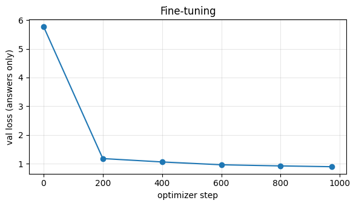

# 05 · Fine-tuning: teaching the model to answer

## Plain idea
A base model only *continues* text. Ask it "What is the capital of France?" and it might write an essay about *capital* in economics. That's what ours did.

**Supervised fine-tuning (SFT):** keep training the same model, but now only on example conversations. It learns the pattern *"user asks → I answer → I stop"*. This is the same step that turns GPT-style base models into chat assistants, just much smaller.

## The chat format
Every conversation becomes one token sequence using the special tokens from [01](01_tokenizer.md):

```
<|user|>
Which is a species of fish? Prickleback or Prickle<|end|>
<|assistant|>
Prickleback<|end|>
<|endoftext|>
```

## Loss masking: grade only the answer
We don't want the model to learn to *ask* questions like a user, only to answer. So every token of the user turn gets the label **−100**, which PyTorch's `cross_entropy` skips:

```
tokens: <|user|> Which is … Prickle <|end|> <|assistant|>  P   rick  le  back  <|end|>
labels:   -100    -100  …   -100   -100      -100        P   rick  le  back  <|end|>
                         not graded                            graded ✔
```
We also grade the `<|end|>` token. That's how the model learns **when to stop**, and the app stops generating as soon as it produces `<|end|>`.

```python
if m["role"] == "user":
    ids += seg; labels += [-100] * len(seg)                 # ignored by the loss
else:
    ids += head + answer + NL; labels += [-100]*len(head) + answer + [-100]*len(NL)
```

## Data and settings (notebook 04)
| | |
|---|---|
| Data | **188k conversations**: SQuAD (86k, answer from a passage), Dolly-15k (15k, open questions), smol-smoltalk (87k, short chats) |
| Dropped | 60k conversations longer than the 1,024-token context (cutting them could cut off the answer) |
| Tokens | 62M, of which **51% are graded** (answers) |
| Learning rate | **1e-4** (pretraining used 6e-4): we want to *adjust* the model, not overwrite it |
| Epochs | 1 (more would overfit) |
| Batching | sorted by length, ≤ 8k tokens per micro-batch, so there's little padding and no out-of-memory surprises |
| Time | **75 min** on one T4 |



Validation loss on answers: **5.77 → 0.90**.

## What changed
| Question | Before | After |
|---|---|---|
| Capital of France? | "Capital is a set of assets…" | "The capital of France is Paris." ✅ |
| Spider legs? | "A spider has a legs. A spider has legs…" | "A spider has six legs." ❌ |
| Largest planet? | "…Earth is the smallest planet…" | "The largest planet in our solar system is the Earth." ❌ |

**SQuAD (300 held-out questions, answer is in the given text): 32.3% exact match, 40.3% F1.**
- *Exact match:* the answer is identical after lower-casing and removing punctuation.
- *F1:* partial credit for overlapping words.

## The lesson
The *format* is perfect: short, confident, stops at the right time. The *facts* are hit-and-miss, because fine-tuning teaches **behaviour, not knowledge**. Knowledge comes from pretraining, and 1.5B tokens into 100M parameters doesn't store much of it.

Reading comprehension (SQuAD) works much better, because the answer is *in the prompt*: the model only has to find and copy it.

That observation drives the next step: **pick a task where the model doesn't need to know facts** → [06](06_distillation.md).

*Note:* HellaSwag (a common-sense benchmark) was planned but skipped, because its download URL returned 404 at run time.
