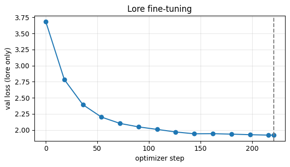

# 06 · Distillation: a 7B teacher trains a 100M student

## Plain idea
Our model can write fluent English but doesn't know facts. So give it a job where **fluency and imagination matter and facts don't**: inventing an original sci-fi universe.

We have no dataset of "tags → space lore". So we **make one** with a much bigger model (the *teacher*), then train our small model (the *student*) to imitate it. This is **knowledge distillation**, and it's how many small open models are built.

```
world_schema.json ─► 22,000 random tag lines ─► Qwen2.5-7B writes lore ─► filters ─► 18–20k pairs ─► fine-tune 100M
```

## Step 1: a world schema (`data/world_schema.json`, `src/lore_schema.py`)
The schema lists **9 kinds of things** (planet, star system, faction, species, character, ship log, artifact, quest hook, station) and the properties each can have:

```
type: planet | name: Oris | climate: tidally locked | size: giant | life: none | danger: extreme
feature: a strange repeating signal | mood: melancholic | located_in: Morenae | length: short
```
- **Names** come from syllable generators ("Ixisia", "Eskaear"), so they are original and never taken from existing franchises.
- **Links** (`located_in`, `homeworld`, `affiliation`) connect entities into one universe.
- **Rules** forbid impossible combinations, and `--selftest` samples 20,000 entities and checks every rule.

Why random tags instead of free prompts? They give *control* (you choose the mood, the danger…) and *variety* (millions of combinations). They also make outputs **checkable**: we know which name must appear and how long the text should be.

## Step 2: the teacher writes (notebook 05)
- **Teacher:** [Qwen2.5-7B-Instruct](https://huggingface.co/Qwen/Qwen2.5-7B-Instruct), Apache-2.0, so its outputs may be used for training. 70× bigger than our model.
- **Engine:** [vLLM](https://github.com/vllm-project/vllm), split across both T4s (*tensor parallel*), fp16. vLLM batches hundreds of requests at once, giving **~870 tokens/s, 5.2 pieces/s**. All 22,000 pieces took **~1.5 h**.
- **Prompt:** a system message with the universe's tone and rules ("prose only, use every name exactly, one surprising detail"), plus a per-type style hint, e.g. ship logs must start with "Day 216." and be first-person.
- The generation loop is **resumable**: every piece is appended to `raw.jsonl`, so a crash loses nothing.

## Step 3: filter (notebook 06, section 1)
A 7B model makes mistakes too. Every piece goes through `lore_schema.check_lore()` and extra filters:

| Filter | Example of what it catches | Dropped |
|---|---|---|
| chatter / leaked tags | "Sure! Here's your lore:", "length: short" | 933 |
| name missing | the given name never appears | 475 |
| repeated opening (capped) | 638 pieces began "In the heart of…" → max 199 each | 439 |
| wrong length | outside 0.8×–1.25× of the target | 434 |
| missing link | `located_in` system not mentioned | 80 |
| franchise terms | "Jedi", "Starfleet", "TARDIS"… | 24 |

**Kept 19,530 / 22,000 (89%).** Near-duplicates (8-word overlap) are removed too.

*My bug, and why checks need checking:* the first version demanded that a ship log mention its author's **name**. But a first-person log says "I", not "Idris Ulon"! The filter kept only 472 of 3,081 logs (15%), and the worst ones. Fixed to "starts with *Day N* and is written in first person" → 2,900 kept.

## Step 4: the student learns (notebook 06)
Same SFT recipe as [05](05_finetuning.md): user turn = tag line, assistant turn = lore, loss only on the lore.

| | |
|---|---|
| Training set | 20,563 conversations (18.9k lore + 1.6k Q&A mixed in so it doesn't forget how to chat), 4.8M tokens |
| Settings | 3 epochs, LR 2e-4 → 2e-5, keep the checkpoint with the best val loss |
| Time | **19 min** on one T4 |
| Val loss | 3.69 → **1.92** (still improving at the end) |



## Step 5: score automatically
45 *unseen* tag lines, same checks for all three models:

| Metric | What it means | Base | **Student** | Teacher |
|---|---|---|---|---|
| passes_all_checks | name, links, length, no franchise terms | 13% | **93%** | 100% |
| uses_name | the given name appears | 53% | **98%** | 100% |
| distinct_4grams | share of unique 4-word phrases (variety) | 0.72 | **0.97** | 0.94 |
| top_opening_share | how often the most common opening appears | 11% | **6.7%** | 2.1% |
| median_words | target ≈ 120 | 173 | **119** | 117 |

Before fine-tuning, the base model just repeated the tags back in a broken table. After: see [`assets/lore_samples.md`](../assets/lore_samples.md).

## Kaggle + vLLM gotchas
- **Re-running the "load teacher" cell without restarting** → out of GPU memory (the old copy is still loaded). The notebook now checks free GPU memory first.
- vLLM 0.34 crashed at start-up importing `cutlass` for a warm-up step of a model we don't use. The fix patches that one warm-up file into a no-op (backup kept), then checks the import in a **subprocess**, because vLLM's worker processes didn't see fixes made only inside the notebook process.
